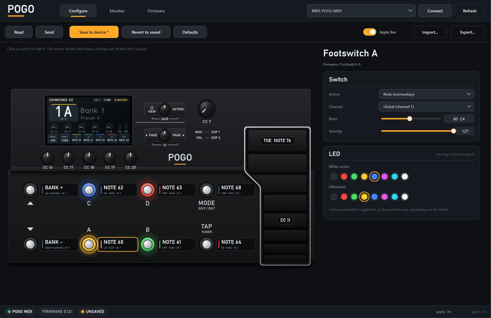

# POGO

Replacement firmware that turns a **Line 6 POD Go** into a configurable **USB MIDI controller**,
plus a desktop app that to configure, emulate, and install the firmware. 

**Note: This app is in no way affiliated with, authorized by or endorsed by Line 6 or Yamaha Music Group.**

**Warning: Using this app or custom firmware may destroy your unit, void your warranty and make you sad. The author accepts no liability. Use at your own risk.**

Tested working on a unit that originally has the 2.50 version of the Line 6 firmware.



- **Firmware** (`firmware/`): every footswitch, button, encoder, the volume knob and the expression
  pedal send MIDI. Each control is configurable over MIDI SysEx and saved on the unit. The LCD shows the preset and the names the host sends, what every
  footswitch and encoder does and its state, and where the pedal and volume sit.
- **App** (`app/`): a JUCE standalone (Windows first). Edits every mapping and global setting,
  applies edits live, saves them on the unit, imports and exports JSON. Contains an **emulator**
  running the same code as the firmware, so the app can be developed and tested with no unit
  attached. On Windows it also **installs the firmware** on the unit — reboot into DFU (Device Firmware Update), load, back
  up the eMMC, install, restore — with nothing else installed.
- **Shared code** (`shared/`): the configuration model, the controller engine, the SysEx protocol,
  the screen drawing and the boot-image format, in plain C, compiled into both the firmware and
  the app. `tests/` exercises it on the host.
- **Docs** (`docs/`): a self-contained specification of the hardware and the software, written so
  that this project can be built on and improved safely without repeating the original hardware
  research. Start at [docs/00-start-here.md](docs/00-start-here.md).


## Quick start

```bash
# Everything: host tests, then the firmware (copied into the app's assets), then the app.
# On Windows, build.bat runs the same with whichever Python 3 it finds
python build.py

# Firmware (needs arm-none-eabi-gcc; see docs/07-building.md for the Python path on this machine)
python firmware/build.py

# Shared library and tests (any CMake + C compiler)
cmake -S . -B build-host -DMIDI_CONTROL_BUILD_APP=OFF && cmake --build build-host && ctest --test-dir build-host

# App (JUCE 8; fetched automatically, or point at a checkout)
cmake -S . -B build-app -DMIDI_CONTROL_JUCE_DIR=/path/to/JUCE && cmake --build build-app --target MidiControlApp
```

Run the app. It starts connected to the emulator: press the virtual footswitches, watch the MIDI
monitor, edit a mapping and see it take effect. With a unit running POGO attached, pick its
MIDI port in the link box; the editor then talks to the real thing.

## Safety

A DFU load only ever touches RAM: pull the power and the unit returns to its previous state. The two things that
are **not** undone by a power cycle are the eMMC and the QSPI NOR. This project never writes the
NOR, and writes the eMMC in exactly two places — the firmware image at sector 0 and the two
configuration slots at sectors 1300 and 1316 — never past sector 1364, the region a verified backup
exists for, and never without reading every sector back. The factory bootloader on the NOR is kept
intact, so holding **PAGE >** while powering on always reaches DFU, from which the backup can be
restored. Full rules: [docs/00-start-here.md](docs/00-start-here.md).

## Layout

```
shared/     the device, minus the hardware: config, engine, protocol, screen, boot image   (C)
firmware/   the board layer: bring-up, scan, ADC, USB, eMMC, and main.c                     (C, ARM)
app/        the JUCE app: links, session, editor, emulator, monitor, firmware installer     (C++)
tests/      host tests for shared/
tools/      midi_control_usb.py (device access from Python) and midi_control_boot_image.py (image format)
docs/       the specification
```

## License

Unless otherwise noted, project-authored files are licensed under the
[GNU Affero General Public License, version 3](LICENSE) (`AGPL-3.0-only`). Third-party components
remain under their respective licences; see [THIRD_PARTY_NOTICES.md](THIRD_PARTY_NOTICES.md).

Manufacturer-provided software and content remain copyrighted by their owner. eMMC backups contain
that material: keep them local (the `backups/` and `captures/` patterns are gitignored).
